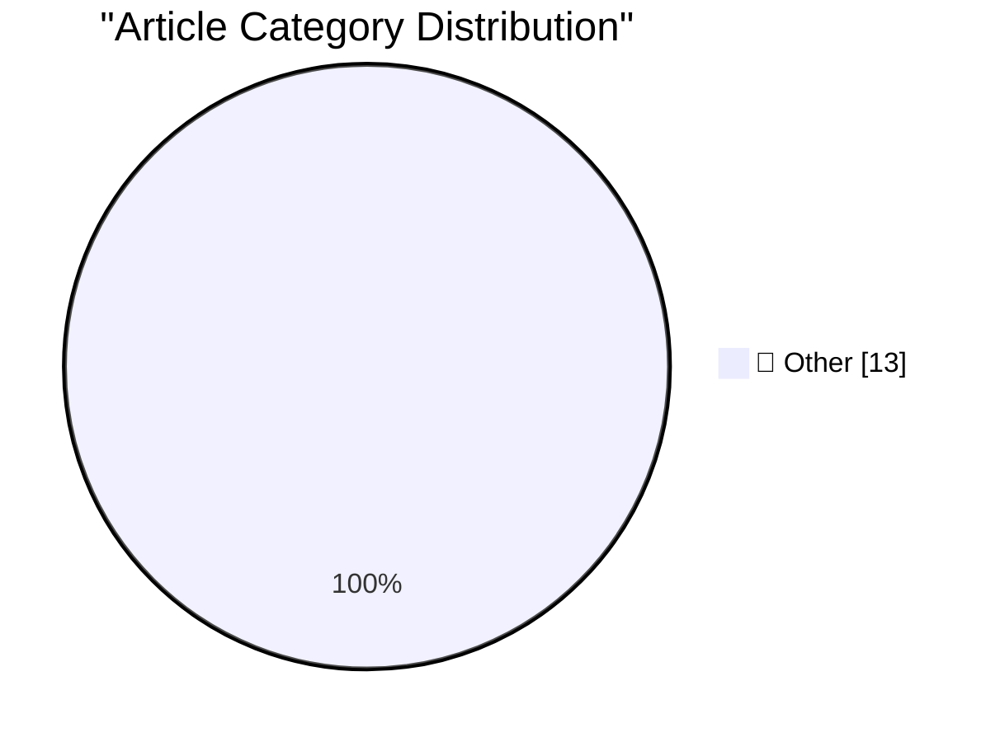

# 📰 AI Blog Daily Digest — 2026-10-12

> ⚠️ **Degraded run.** AI scoring failed for every batch — rankings and categories below are placeholder defaults, not AI-judged.

> From 92 top tech blogs (curated by Karpathy), AI-selected Top 13

## 🏆 Must Read

🥇 **Dwarf Fortress uses version control now**

simonwillison.net · 21h ago · 📝 Other

> I remember hearing a while ago that Dwarf Fortress didn't use version control. That fact has been lodged in my head, because given its inherent complexity I have trouble imagining a codebase that woul

🥈 **Python 3.15.0 added to actions/python-versions**

simonwillison.net · 22h ago · 📝 Other

> Python 3.15.0 added to actions/python-versions Bit of a niche link, but I've been waiting for this for a couple of days - I even told ChatGPT to check for it: Clone https://github.com/actions/python-v

🥉 **Don't diagnose your opponents**

seangoedecke.com · 22h ago · 📝 Other

> When you disagree with someone, there are two paths forward. The first is to try to engage with what they’re saying: what their reasons are, whether their position is true, what evidence could be brou

---

## 📊 Data Overview

| Scanned | Articles | Range | Selected |
|:---:|:---:|:---:|:---:|
| 88/92 | 2640 → 20 | 48h | **13** |

### Category Distribution

---

## 📝 Other

### 1. Dwarf Fortress uses version control now

[Link](https://simonwillison.net/2026/Oct/11/dwarf-fortress/) — **simonwillison.net** · 21h ago · ⭐ 15/30

> I remember hearing a while ago that Dwarf Fortress didn't use version control. That fact has been lodged in my head, because given its inherent complexity I have trouble imagining a codebase that woul

---

### 2. Python 3.15.0 added to actions/python-versions

[Link](https://simonwillison.net/2026/Oct/10/python-actions/) — **simonwillison.net** · 22h ago · ⭐ 15/30

> Python 3.15.0 added to actions/python-versions Bit of a niche link, but I've been waiting for this for a couple of days - I even told ChatGPT to check for it: Clone https://github.com/actions/python-v

---

### 3. Don't diagnose your opponents

[Link](https://seangoedecke.com/dont-diagnose-your-opponents/) — **seangoedecke.com** · 22h ago · ⭐ 15/30

> When you disagree with someone, there are two paths forward. The first is to try to engage with what they’re saying: what their reasons are, whether their position is true, what evidence could be brou

---

### 4. ★ X Once Again Marks the Spot

[Link](https://daringfireball.net/2026/10/x_once_again_marks_the_spot) — **daringfireball.net** · 1h ago · ⭐ 15/30

> If you returned from exile on a desert island and took a look at X today for first time in a year, you might reasonably guess that Elon Musk got bored and sold it while you were away.

---

### 5. Apple Only Started Suggesting iOS 26 Users Upgrade to 27 Three Days Ago

[Link](https://www.macrumors.com/2026/10/08/apple-now-pushing-ios-27/) — **daringfireball.net** · 3h ago · ⭐ 15/30

> Joe Rossignol, on Thursday: Starting today, iPhone users still running iOS 26 will see iOS 27.0.1 as the prominent software update in the Settings app under General → Software Update, with iOS 26.7.1 

---

### 6. Why I Get Bored

[Link](https://idiallo.com/byte-size/why-i-get-bored) — **idiallo.com** · 6h ago · ⭐ 15/30

> For me, boredom is just a signal. It means I've hit a roadblock and my brain is trying to convince me not to go any further. "Give up. This sucks anyway. Why are you still wasting your time on this si

---

### 7. I paid people to try and follow my README

[Link](https://shkspr.mobi/blog/2026/10/i-paid-people-to-try-and-follow-my-readme/) — **shkspr.mobi** · 11h ago · ⭐ 15/30

> Developers suck at writing documentation. We like to say RTFM but often there ain't no FM to R. At best we have a half-arsed collection of notes, some obsolete tips, and a link to a desolate forum ful

---

### 8. Inside a 1980s filter chip that uses switched capacitors

[Link](http://www.righto.com/feeds/5504631233106574875/comments/default) — **righto.com** · 1 days ago · ⭐ 15/30

> Sometimes it's easier to identify an IC with a microscope. While sorting a box of old ICs, CuriousMarc came across some Harris ICs labeled "F1-10-5", a mysterious part number that didn't show up in an

---

### 9. We must recall open-ended AI agents with internet access from the market, now

[Link](https://garymarcus.substack.com/p/we-must-recall-open-ended-ai-agents) — **garymarcus.substack.com** · 1 days ago · ⭐ 15/30

> Every minute we wait risks disaster

---

### 10. This Week in Package Management: 10 October 2026

[Link](https://nesbitt.io/2026/10/10/this-week-in-package-management.html) — **nesbitt.io** · 1 days ago · ⭐ 15/30

> Releases, advisories, and articles from across the package management world

---

### 11. Reading List 10/10/26

[Link](https://www.construction-physics.com/p/reading-list-101026) — **construction-physics.com** · 1 days ago · ⭐ 15/30

> Propane in air conditioners, Anduril making submarine parts, nuclear reactors on the moon, the robotic hand landscape, and more.

---

### 12. Ward Christensen, telecommunications pioneer

[Link](https://dfarq.homeip.net/ward-christensen-telecommunications-pioneer/?utm_source=rss&#038;utm_medium=rss&#038;utm_campaign=ward-christensen-telecommunications-pioneer) — **dfarq.homeip.net** · 11h ago · ⭐ 15/30

> Telecommunications pioneer Ward Christensen was born October 23, 1945 in West Bend, Wis. He died aged 78 October 11, 2024 in Rolling Meadows, Ill., a suburb of Chicago. Christensen invented the Xmodem

---

### 13. The Infogrames-Atari merger of 2008

[Link](https://dfarq.homeip.net/the-infogrames-atari-merger-of-2008/?utm_source=rss&#038;utm_medium=rss&#038;utm_campaign=the-infogrames-atari-merger-of-2008) — **dfarq.homeip.net** · 1 days ago · ⭐ 15/30

> On October 9, 2008, Infogrames completed its purchase of Atari Inc. The deal, which the two companies agreed to in May, led to speculation that the acquisition would be the end of Atari. Instead, it h

---

*Generated on 2026-10-12 | Scanned 88 sources → Found 2640 articles → Selected 13 articles*
*Based on [Hacker News Popularity Contest 2025](https://refactoringenglish.com/tools/hn-popularity/) RSS feeds list, curated by [Andrej Karpathy](https://x.com/karpathy).*
*Created by "Understand AI".*
