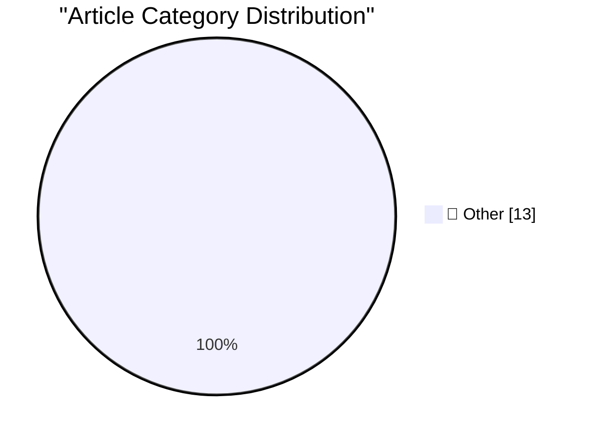

# 📰 AI Blog Daily Digest — 2026-10-13

> ⚠️ **Degraded run.** AI scoring failed for every batch — rankings and categories below are placeholder defaults, not AI-judged.

> From 92 top tech blogs (curated by Karpathy), AI-selected Top 13

## 🏆 Must Read

🥇 **Hello Python 3.15, goodbye 3.10, and now I can use 3.11**

simonwillison.net · 4h ago · 📝 Other

> Python 3.15 is here ! Here's the essential What's new in Python 3.15 guide, this year curated by 3.14 and 3.15 release manager Hugo van Kemenade. As someone who builds open source software that works 

🥈 **datasette-ports 0.4**

simonwillison.net · 17h ago · 📝 Other

> Release: datasette-ports 0.4 My plugin for detecting and listing all Datasette instances on the current machine now works with the latest version, and displays the detected PID as well. Knowing the PI

🥉 **Software engineers don't get to be Luddites about AI**

seangoedecke.com · 22h ago · 📝 Other

> Many software engineers are righteously angry about AI. It’s understandable to be upset that the skills you built your professional identity around are getting automated away. But software engineers a

---

## 📊 Data Overview

| Scanned | Articles | Range | Selected |
|:---:|:---:|:---:|:---:|
| 87/92 | 2611 → 21 | 48h | **13** |

### Category Distribution

---

## 📝 Other

### 1. Hello Python 3.15, goodbye 3.10, and now I can use 3.11

[Link](https://simonwillison.net/2026/Oct/12/python-3-15/) — **simonwillison.net** · 4h ago · ⭐ 15/30

> Python 3.15 is here ! Here's the essential What's new in Python 3.15 guide, this year curated by 3.14 and 3.15 release manager Hugo van Kemenade. As someone who builds open source software that works 

---

### 2. datasette-ports 0.4

[Link](https://simonwillison.net/2026/Oct/12/datasette-ports/) — **simonwillison.net** · 17h ago · ⭐ 15/30

> Release: datasette-ports 0.4 My plugin for detecting and listing all Datasette instances on the current machine now works with the latest version, and displays the detected PID as well. Knowing the PI

---

### 3. Software engineers don't get to be Luddites about AI

[Link](https://seangoedecke.com/software-engineers-dont-get-to-be-luddites-about-ai/) — **seangoedecke.com** · 22h ago · ⭐ 15/30

> Many software engineers are righteously angry about AI. It’s understandable to be upset that the skills you built your professional identity around are getting automated away. But software engineers a

---

### 4. Mark Stephens, a.k.a. Robert X. Cringely, Died at 73

[Link](https://www.facebook.com/story.php?story_fbid=pfbid0YbCLrAJfBirAWuPBy4a7pauaQ6gHkAPUwtbzyg2wAjeMcruFC7dWUZKQJKkNChP9l&amp;id=536506060&amp;_rdr) — **daringfireball.net** · 5h ago · ⭐ 15/30

> Mary Alyce Stephens (née Neader), posting on Cringely’s Facebook account: Hello, this is Mary Alyce, Bob’s wife. I am coming to you with immense sadness to let you know that Bob passed away. His obitu

---

### 5. Pluralistic: How labor rights rescued Ultima from a monopolist (12 Oct 2026)

[Link](https://pluralistic.net/2026/10/12/termination-of-transfer/) — **pluralistic.net** · 10h ago · ⭐ 15/30

> Today's links How labor rights rescued Ultima from a monopolist: If you care about labor justice and artists' rights, stop focusing on copyright. Hey look at this: Delights to delectate. Object perman

---

### 6. Categorical models of logics

[Link](https://www.johndcook.com/blog/2026/10/12/categorical-models-of-logics/) — **johndcook.com** · 9h ago · ⭐ 15/30

> A few days ago I wrote about topological models of modal logic. If you find general topology more familiar than modal logic, this correspondence could be helpful. If you think the motivation for gener

---

### 7. Just say no to OpenAI and Anthropic

[Link](https://micahflee.com/just-say-no-to-openai-and-anthropic/) — **micahflee.com** · 23h ago · ⭐ 15/30

> I recently read End Times Fascism and the Fight for the Living World by Naomi Klein and Astra Taylor. It&apos;s an excellent book and I highly recommend that everyone read it. Tech oligarchs make up a

---

### 8. Now That’s What I Call Technical Debt!

[Link](https://nesbitt.io/2026/10/12/now-thats-what-i-call-technical-debt.html) — **nesbitt.io** · 13h ago · ⭐ 15/30

> 15 chart-topping hits about unpaid maintainers and overconfident AI agents.

---

### 9. The X is Off-Target

[Link](https://feed.tedium.co/link/15204/17494770/x-social-media-monoliths-critique) — **tedium.co** · 6h ago · ⭐ 15/30

> Is X good again? That's probably the wrong question. The right one: Are we past the era when a single social network needs to be everything to everyone?

---

### 10. The Fascinating World of Domains

[Link](https://blog.jim-nielsen.com/2026/domains-article-on-wired/) — **blog.jim-nielsen.com** · 1 days ago · ⭐ 15/30

> Pete Millspaugh has a lovely article over on WIRED that peers into the world of domains. (If you’re as interested in the esoteric details of domains as I am, follow Pete’s writing at Dot Com Press .) 

---

### 11. Nvidia’s first GPU: GeForce 256

[Link](https://dfarq.homeip.net/nvidias-first-gpu-geforce-256/?utm_source=rss&#038;utm_medium=rss&#038;utm_campaign=nvidias-first-gpu-geforce-256) — **dfarq.homeip.net** · 11h ago · ⭐ 15/30

> On October 11, 1999, Nvidia released its GeForce 256, its first product that it described as a GPU. What made the Nvidia GeForce 256 the first GPU? I’m sure 3dfx fans would argue that 3dfx made GPUs, 

---

### 12. Refurb weekend II: Alpha Micro Eagle 300 and friends

[Link](https://oldvcr.blogspot.com/feeds/3996311687258717625/comments/default) — **oldvcr.blogspot.com** · 20h ago · ⭐ 15/30

> This Refurb Weekend is a sequel in two ways. Six years ago I fixed the power supply and case fan in my 68EC030-based Alpha Microsystems Eagle 300, a more modernized and substantially faster Alpha Micr

---

### 13. from plesiochronous to synchronous

[Link](https://computer.rip/2026-10-12-plesiochronous.html) — **computer.rip** · 22h ago · ⭐ 15/30

> Up until the 1960s, telephone calls were carried as analog signals. There was a great deal of frequency division multiplexing onto open wire , and sometimes coaxial cables , but in the post-war period

---

*Generated on 2026-10-13 | Scanned 87 sources → Found 2611 articles → Selected 13 articles*
*Based on [Hacker News Popularity Contest 2025](https://refactoringenglish.com/tools/hn-popularity/) RSS feeds list, curated by [Andrej Karpathy](https://x.com/karpathy).*
*Created by "Understand AI".*
