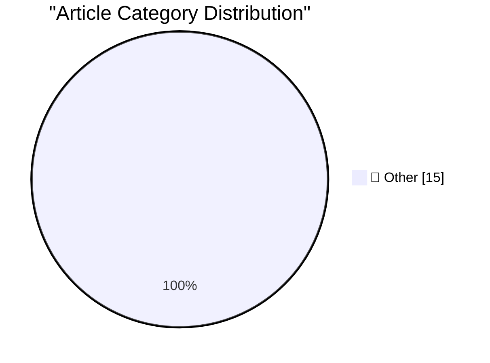

# 📰 AI Blog Daily Digest — 2026-10-14

> ⚠️ **Degraded run.** AI scoring failed for every batch — rankings and categories below are placeholder defaults, not AI-judged.

> From 92 top tech blogs (curated by Karpathy), AI-selected Top 15

## 🏆 Must Read

🥇 **Quoting Geoffrey Huntley**

simonwillison.net · 9h ago · 📝 Other

> If the agent isn't using my diagnostics library, I could introspect and update AGENTS.md, but there's still a delta, and it'll drift. Instead, I write a pre-commit hook that checks the git diff for di

🥈 **Profiling web-edit with Python 3.15: flame graphs and source heatmaps**

simonwillison.net · 1 days ago · 📝 Other

> Research: Profiling web-edit with Python 3.15: flame graphs and source heatmaps I put the new Python 3.15 profiler through its paces by having GPT-6 Astra Extra High in Codex run it against my new web

🥉 **web-edit 0.1a0**

simonwillison.net · 1 days ago · 📝 Other

> Release: web-edit 0.1a0 I was working on a project from my phone using Codex Remote when I found myself wanting to edit a credentials file without round-tripping those credentials through the LLM itse

---

## 📊 Data Overview

| Scanned | Articles | Range | Selected |
|:---:|:---:|:---:|:---:|
| 82/92 | 2497 → 28 | 48h | **15** |

### Category Distribution

---

## 📝 Other

### 1. Quoting Geoffrey Huntley

[Link](https://simonwillison.net/2026/Oct/13/geoffrey-huntley/) — **simonwillison.net** · 9h ago · ⭐ 15/30

> If the agent isn't using my diagnostics library, I could introspect and update AGENTS.md, but there's still a delta, and it'll drift. Instead, I write a pre-commit hook that checks the git diff for di

---

### 2. Profiling web-edit with Python 3.15: flame graphs and source heatmaps

[Link](https://simonwillison.net/2026/Oct/12/python-3-15-web-edit-profiling/) — **simonwillison.net** · 1 days ago · ⭐ 15/30

> Research: Profiling web-edit with Python 3.15: flame graphs and source heatmaps I put the new Python 3.15 profiler through its paces by having GPT-6 Astra Extra High in Codex run it against my new web

---

### 3. web-edit 0.1a0

[Link](https://simonwillison.net/2026/Oct/12/web-edit/) — **simonwillison.net** · 1 days ago · ⭐ 15/30

> Release: web-edit 0.1a0 I was working on a project from my phone using Codex Remote when I found myself wanting to edit a credentials file without round-tripping those credentials through the LLM itse

---

### 4. Apple HomeView

[Link](https://www.apple.com/newsroom/2026/10/meet-apple-homeview-a-new-way-to-enjoy-entertainment-and-manage-the-home/) — **daringfireball.net** · 7h ago · ⭐ 15/30

> Apple Newsroom: Apple today introduced Apple HomeView , designed to be central to the home and personal to everyone in it. With a stunning 7-inch Liquid Retina display, HomeView brings entertainment, 

---

### 5. The Last Answer

[Link](https://idiallo.com/blog/the-last-answer) — **idiallo.com** · 12h ago · ⭐ 15/30

> Read the non-interactive version . The next morning was the apocalypse that Amodei had predicted. Only there wasn’t any fire, there wasn’t a mob of protesters, the power wasn’t even cut off. We were a

---

### 6. Pluralistic: Bundestrojaner (13 Oct 2026)

[Link](https://pluralistic.net/2026/10/13/petards-r-us/) — **pluralistic.net** · 10h ago · ⭐ 15/30

> Today's links Bundestrojaner: You can't make people more secure by making them less secure. Hey look at this: Delights to delectate. Object permanence: 9/11 sitcom; Jon Norman v Philcon; Bruce Sterlin

---

### 7. Book Review: The Thousand Deaths of Romeo and Juliet - Caroline Finch ★★★★★

[Link](https://shkspr.mobi/blog/2026/10/book-review-the-thousand-deaths-of-romeo-and-juliet-caroline-finch/) — **shkspr.mobi** · 11h ago · ⭐ 15/30

> The thing about Romeo and Juliet is that it is a true story. It isn't literally true, but it is literary true. We see the same motif repeated throughout all cultures and all times. Caroline Lea (writi

---

### 8. C++ futures part 2: The mental model for std::promise, std::packaged_task

[Link](https://devblogs.microsoft.com/oldnewthing/20261013-00/?p=112769/) — **devblogs.microsoft.com/oldnewthing** · 8h ago · ⭐ 15/30

> Building things out of the state. The post C++ futures part 2: The mental model for std::promise , std::packaged_task appeared first on The Old New Thing .

---

### 9. C++ futures part 1: The mental model

[Link](https://devblogs.microsoft.com/oldnewthing/20261012-00/?p=112767/) — **devblogs.microsoft.com/oldnewthing** · 1 days ago · ⭐ 15/30

> Managing a value that is produced later. The post C++ futures part 1: The mental model appeared first on The Old New Thing .

---

### 10. Could this be the Frontier Labs’ WeWork moment?

[Link](https://garymarcus.substack.com/p/could-this-be-the-frontier-labs-wework) — **garymarcus.substack.com** · 22h ago · ⭐ 15/30

> Some ominous signs

---

### 11. Harmonic triangle

[Link](https://www.johndcook.com/blog/2026/10/13/harmonic-triangle/) — **johndcook.com** · 9h ago · ⭐ 15/30

> Pascal’s triangle is the most famous triangular arrangement of numbers. I’ve written about other numerical triangles, such as Bell’s triangle and the trinomial triangle. There’s another well-known tri

---

### 12. Annualized Enron Rate

[Link](https://www.wheresyoured.at/annualized-enron-rate/) — **wheresyoured.at** · 6h ago · ⭐ 15/30

> If you liked this piece, you should subscribe to my premium newsletter, and you can subscribe on the following links: &#x24;70 a year , &#x24;18 a quarter , or &#x24;7 a month . In return, you get a w

---

### 13. The Dock on Mac, From OS 10 to macOS 27

[Link](https://blog.jim-nielsen.com/2026/macos-dock-icons-over-time/) — **blog.jim-nielsen.com** · 1 days ago · ⭐ 15/30

> I wrote the chapter on app icon history for The iOS App Icon Book . The other day I found an old note stashed away where I had started researching the macOS version of that chapter (which Michael ulti

---

### 14. What happened to Ashton-Tate and dBase

[Link](https://dfarq.homeip.net/what-happened-to-ashton-tate-and-dbase/?utm_source=rss&#038;utm_medium=rss&#038;utm_campaign=what-happened-to-ashton-tate-and-dbase) — **dfarq.homeip.net** · 11h ago · ⭐ 15/30

> Microsoft Access didn’t exist in the MS-DOS era. For that matter, Microsoft wasn’t even a player in databases until relatively late in the MS-DOS era. The dominant database during most of the DOS era 

---

### 15. Subterranean Warfare – An Urgent DoW Need Without An Owner

[Link](https://steveblank.com/2026/10/13/subterranean-warfare-an-urgent-dow-need-without-an-owner/) — **steveblank.com** · 9h ago · ⭐ 15/30

> This article previously appeared in Cipher Brief. The DoW urgently needs to organize its scattered subterranean warfare assets into a single unified organization. Ideally, a Direct Reporting Portfolio

---

*Generated on 2026-10-14 | Scanned 82 sources → Found 2497 articles → Selected 15 articles*
*Based on [Hacker News Popularity Contest 2025](https://refactoringenglish.com/tools/hn-popularity/) RSS feeds list, curated by [Andrej Karpathy](https://x.com/karpathy).*
*Created by "Understand AI".*
