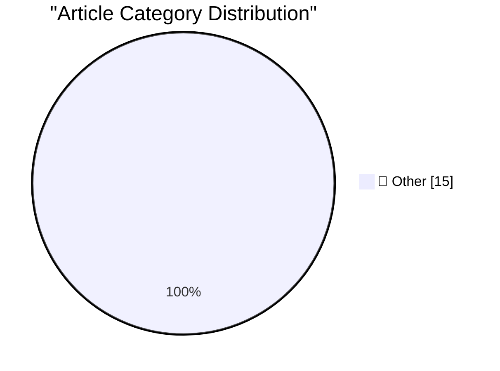

# 📰 AI Blog Daily Digest — 2026-10-15

> ⚠️ **Degraded run.** AI scoring failed for every batch — rankings and categories below are placeholder defaults, not AI-judged.

> From 92 top tech blogs (curated by Karpathy), AI-selected Top 15

## 🏆 Must Read

🥇 **AI is mass decompiling games. That's both awesome and scary.**

simonwillison.net · 6h ago · 📝 Other

> AI is mass decompiling games. That&#x27;s both awesome and scary. Indie game developer Popcar talks about the recent wave of AI-powered decompilation of existing games, enabling weird mashups between 

🥈 **Redesigning source control at Anthropic**

simonwillison.net · 1 days ago · 📝 Other

> Redesigning source control at Anthropic Interesting piece from Anthropic describing why and how they built their own custom alternative to Git, based on the dramatic increase in rate of changes to the

🥉 **llm-gemini 0.35**

simonwillison.net · 1 days ago · 📝 Other

> Release: llm-gemini 0.35 I added support to llm-gemini for the new Gemini 4 Argon model, made available today via the Gemini API and for customers of their $100/month subscription plan. Here are the l

---

## 📊 Data Overview

| Scanned | Articles | Range | Selected |
|:---:|:---:|:---:|:---:|
| 83/92 | 2527 → 31 | 48h | **15** |

### Category Distribution

---

## 📝 Other

### 1. AI is mass decompiling games. That's both awesome and scary.

[Link](https://simonwillison.net/2026/Oct/14/ai-is-mass-decompiling-games/) — **simonwillison.net** · 6h ago · ⭐ 15/30

> AI is mass decompiling games. That&#x27;s both awesome and scary. Indie game developer Popcar talks about the recent wave of AI-powered decompilation of existing games, enabling weird mashups between 

---

### 2. Redesigning source control at Anthropic

[Link](https://simonwillison.net/2026/Oct/13/redesigning-source-control-at-anthropic/) — **simonwillison.net** · 1 days ago · ⭐ 15/30

> Redesigning source control at Anthropic Interesting piece from Anthropic describing why and how they built their own custom alternative to Git, based on the dramatic increase in rate of changes to the

---

### 3. llm-gemini 0.35

[Link](https://simonwillison.net/2026/Oct/13/llm-gemini/) — **simonwillison.net** · 1 days ago · ⭐ 15/30

> Release: llm-gemini 0.35 I added support to llm-gemini for the new Gemini 4 Argon model, made available today via the Gemini API and for customers of their $100/month subscription plan. Here are the l

---

### 4. web-edit 0.1a1

[Link](https://simonwillison.net/2026/Oct/13/web-edit/) — **simonwillison.net** · 1 days ago · ⭐ 15/30

> Release: web-edit 0.1a1 Includes performance optimizations written by Claude Opus 5.5 after I fed it this Python 3.15 profiling report generated by GPT-6 Astra. Tags: profiling , projects

---

### 5. llm-meta-ai 0.2

[Link](https://simonwillison.net/2026/Oct/12/llm-meta-ai/) — **simonwillison.net** · 1 days ago · ⭐ 15/30

> Release: llm-meta-ai 0.2 Meta AI release Muse Wonder (and Muse Wonder Full), their new "most capable models". These look like they may be Meta's first Fable class models - Artificial Analysis scores M

---

### 6. Formlabs dropped the Raspberry Pi on the way to a $699 SLA printer

[Link](https://www.jeffgeerling.com/blog/2026/formlabs-form-studio-1-resin-printer/) — **jeffgeerling.com** · 10h ago · ⭐ 15/30

> Formlabs sent me a Form Studio 1 resin 3D printer to test after years of back-and-forth about their Form 4 printer. Like the Form 4, it's an SLA (stereolithography) printer, but unlike the Form 4 (whi

---

### 7. U.K. Sanctions Cryptomus for RU Money Laundering

[Link](https://krebsonsecurity.com/2026/10/u-k-sanctions-cryptomus-for-ru-money-laundering/) — **krebsonsecurity.com** · 8h ago · ⭐ 15/30

> The United Kingdom has issued economic sanctions against Cryptomus, a chameleonic cryptocurrency platform that experts say serves as a major conduit for payments related to ransomware, narcotics, dark

---

### 8. Microsoft Patches More Than 1,400 Security Flaws

[Link](https://krebsonsecurity.com/2026/10/microsoft-patches-more-than-1400-security-flaws/) — **krebsonsecurity.com** · 23h ago · ⭐ 15/30

> Microsoft today issued updates to fix more than 1,400 security vulnerabilities in its Windows operating systems and other software. Today's epic patch batch dwarfs September's record of nearly 1,000 f

---

### 9. [Sponsor] WorkOS AuthKit: Auth for Your App, Free Up to 1M Monthly Active Users

[Link](https://workos.com/?utm_source=daringfireball&amp;utm_medium=newsletter&amp;utm_campaign=q42026) — **daringfireball.net** · 1h ago · ⭐ 15/30

> Login looks simple until you’re building password resets, email verification, MFA, social providers, session management, and the enterprise SSO your first big customer asked for last week. AuthKit let

---

### 10. The FBI Arrested a Saudi National OpenAI Employee for Planting a Recording Device in the Company’s Executive Conference Room

[Link](https://www.justice.gov/opa/pr/saudi-national-arrested-installing-surreptitious-audio-recording-device-openai) — **daringfireball.net** · 2h ago · ⭐ 15/30

> The Department of Justice, yesterday: An employee of OpenAI has been arrested for and charged with using or endeavoring to use an electronic, mechanical, or other device to intercept oral communicatio

---

### 11. The Internet of Very Cheap Things

[Link](https://shkspr.mobi/blog/2026/10/the-internet-of-very-cheap-things/) — **shkspr.mobi** · 11h ago · ⭐ 15/30

> Twelve years ago, I was complaining that IoT devices were too expensive. Last week I bought a colour changing Zigbee lighbulb for £4. Not a typo - less than a fiver. While the aipocalypse is devouring

---

### 12. "No way to prevent this" say users of only language where this regularly happens

[Link](https://xeiaso.net/shitposts/no-way-to-prevent-this/memory-safety/CVE-2026-92392/) — **xeiaso.net** · 23h ago · ⭐ 15/30

> In the hours following the release of CVE-2026-92392 for the project curl , site reliability workers and systems administrators scrambled to desperately rebuild and patch all their systems to fix a us

---

### 13. It remains “very difficult [to find] actual, materially measurable financial impacts” from spending on AI, per new study

[Link](https://garymarcus.substack.com/p/it-remains-very-difficult-to-find) — **garymarcus.substack.com** · 21h ago · ⭐ 15/30

> Yet another study pointing in the same direction

---

### 14. LaTeX package for Pascal-like triangles

[Link](https://www.johndcook.com/blog/2026/10/14/latex-package-for-pascal-like-triangles/) — **johndcook.com** · 5h ago · ⭐ 15/30

> When I wrote about the harmonic triangle yesterday, I displayed the triangle left-aligned using fixed-width text because that was easier than producing the format you usually see for Pascal’s triangle

---

### 15. A generalization of the Pythagorean theorem

[Link](https://www.johndcook.com/blog/2026/10/14/pythagorean-variation/) — **johndcook.com** · 11h ago · ⭐ 15/30

> G. D. Chakerian [1] discovered the following generalization of the Pythagorean theorem. Take any triangle and attach squares to each side. From each triangle vertex, extend a line perpendicular to the

---

*Generated on 2026-10-15 | Scanned 83 sources → Found 2527 articles → Selected 15 articles*
*Based on [Hacker News Popularity Contest 2025](https://refactoringenglish.com/tools/hn-popularity/) RSS feeds list, curated by [Andrej Karpathy](https://x.com/karpathy).*
*Created by "Understand AI".*
