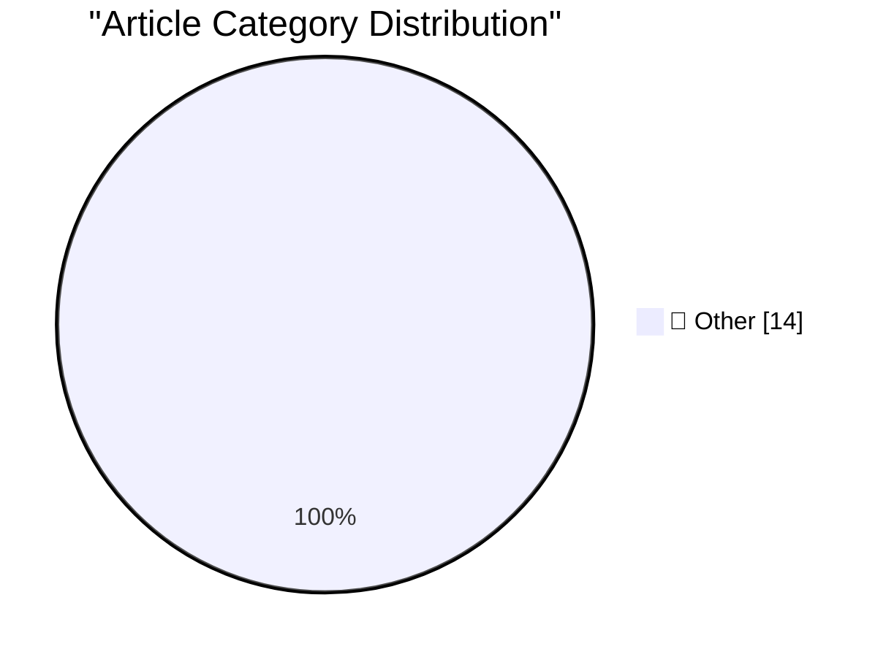

# 📰 AI Blog Daily Digest — 2026-10-16

> ⚠️ **Degraded run.** AI scoring failed for every batch — rankings and categories below are placeholder defaults, not AI-judged.

> From 92 top tech blogs (curated by Karpathy), AI-selected Top 14

## 🏆 Must Read

🥇 **Chirp Pong**

simonwillison.net · 2h ago · 📝 Other

> Tool: Chirp Pong Another game experiment - I wanted to see if it was feasible to have a two player game on two separate phones running in static HTML where the networking code uses chirps sent via the

🥈 **Anthropic tells investors quarterly revenue up nearly 50% to $16.8bn ahead of IPO**

simonwillison.net · 9h ago · 📝 Other

> Anthropic tells investors quarterly revenue up nearly 50% to $16.8bn ahead of IPO The phrase "told investors" appears four times in this FT article, which reports on Anthropic's day of hosting investo

🥉 **Tree Appreciator**

simonwillison.net · 1 days ago · 📝 Other

> Tool: Tree Appreciator Another game experiment with Claude. This one used the default Claude iPhone app (chat mode, not Claude Code mode), where I prompted Claude Opus 5.5 Max with: Build a three js g

---

## 📊 Data Overview

| Scanned | Articles | Range | Selected |
|:---:|:---:|:---:|:---:|
| 87/92 | 2624 → 26 | 48h | **14** |

### Category Distribution

---

## 📝 Other

### 1. Chirp Pong

[Link](https://simonwillison.net/2026/Oct/15/chirp-pong/) — **simonwillison.net** · 2h ago · ⭐ 15/30

> Tool: Chirp Pong Another game experiment - I wanted to see if it was feasible to have a two player game on two separate phones running in static HTML where the networking code uses chirps sent via the

---

### 2. Anthropic tells investors quarterly revenue up nearly 50% to $16.8bn ahead of IPO

[Link](https://simonwillison.net/2026/Oct/15/anthropic-tells-investors/) — **simonwillison.net** · 9h ago · ⭐ 15/30

> Anthropic tells investors quarterly revenue up nearly 50% to $16.8bn ahead of IPO The phrase "told investors" appears four times in this FT article, which reports on Anthropic's day of hosting investo

---

### 3. Tree Appreciator

[Link](https://simonwillison.net/2026/Oct/14/tree-appreciator/) — **simonwillison.net** · 1 days ago · ⭐ 15/30

> Tool: Tree Appreciator Another game experiment with Claude. This one used the default Claude iPhone app (chat mode, not Claude Code mode), where I prompted Claude Opus 5.5 Max with: Build a three js g

---

### 4. Secret Documents Reveal Donors Behind $330 Million for Trump’s Ballroom — Apple and Nvidia Top the List at $25 Million Each

[Link](https://www.washingtonpost.com/investigations/2026/10/15/secret-documents-reveal-donors-behind-330-million-trumps-ballroom/) — **daringfireball.net** · 6h ago · ⭐ 15/30

> Jonathan O’Connell, Sarah Blaskey, and Aaron Schaffer, reporting for The Washington Post ( News+ link ; Archive.today link ): A list obtained by The Washington Post reveals all the major donors to Pre

---

### 5. Pluralistic: Expedia amazoned hotel rooms (15 Oct 2026)

[Link](https://pluralistic.net/2026/10/15/enshittipedia/) — **pluralistic.net** · 11h ago · ⭐ 15/30

> Today's links Expedia amazoned hotel rooms: Everything more expensive for everyone, monopolies everywhere, and we're all screwed. Hey look at this: Delights to delectate. Object permanence: Delta v do

---

### 6. C++ futures part 4: What if I want an immediate on-thread std::async?

[Link](https://devblogs.microsoft.com/oldnewthing/20261015-00/?p=112776/) — **devblogs.microsoft.com/oldnewthing** · 8h ago · ⭐ 15/30

> Providing the case that the C++ language won't do. The post C++ futures part 4: What if I want an immediate on-thread std::async ? appeared first on The Old New Thing .

---

### 7. C++ futures part 3: The mental model for std::async

[Link](https://devblogs.microsoft.com/oldnewthing/20261014-00/?p=112774/) — **devblogs.microsoft.com/oldnewthing** · 1 days ago · ⭐ 15/30

> Doing things later in different ways. The post C++ futures part 3: The mental model for std::async appeared first on The Old New Thing .

---

### 8. Generative AI in disarray

[Link](https://garymarcus.substack.com/p/generative-ai-in-disarray) — **garymarcus.substack.com** · 20h ago · ⭐ 15/30

> Seven brief items from Delhi.

---

### 9. Poe, Bessel, and Drones

[Link](https://www.johndcook.com/blog/2026/10/14/poe-bessel-and-drones/) — **johndcook.com** · 1 days ago · ⭐ 15/30

> What’s a connection between Edgar Allan Poe and Friedrich Wilhelm Bessel? Poe’s story The Pit and the Pendulum describes a pendulum with a semicircular blade being lowered on a cable. This is an inter

---

### 10. How to Train Your Robot

[Link](https://www.construction-physics.com/p/how-to-train-your-robot) — **construction-physics.com** · 8h ago · ⭐ 15/30

> The enormous advance in AI capabilities over the last several years has in large part been driven by the availability of vast amounts of training data.

---

### 11. We Need All the Disciplines

[Link](https://blog.jim-nielsen.com/2026/we-need-all-disciplines/) — **blog.jim-nielsen.com** · 3h ago · ⭐ 15/30

> From where I sit, figuring out what to build, building it, and shipping it are all part of the art of making software. Many disciplines have emerged through the years to facilitate this work: product,

---

### 12. What was a Token Ring network?

[Link](https://dfarq.homeip.net/what-was-a-token-ring-network/?utm_source=rss&#038;utm_medium=rss&#038;utm_campaign=what-was-a-token-ring-network) — **dfarq.homeip.net** · 11h ago · ⭐ 15/30

> What was a Token Ring network? Token Ring is an obsolete networking technology that competed with Ethernet in the 1980s and 1990s. IBM first announced it October 15, 1985. It is more of a curiosity to

---

### 13. When SCO fired Darl McBride

[Link](https://dfarq.homeip.net/when-sco-fired-darl-mcbride/?utm_source=rss&#038;utm_medium=rss&#038;utm_campaign=when-sco-fired-darl-mcbride) — **dfarq.homeip.net** · 1 days ago · ⭐ 15/30

> On October 14, 2009, SCO fired its CEO, Darl McBride. Very nearly 15 years later, McBride died at the age of 64 of complications from ALS. His termination from SCO ended his time as the most hated man

---

### 14. The still unregulated solar power clouds: notes from 9th E.DSO – EE-ISAC - ENCS – ENISA Cybersecurity Forum

[Link](https://berthub.eu/articles/posts/solar-nightmare-at-the-conference/) — **berthub.eu** · 1 days ago · ⭐ 15/30

> Last week I attended the 9th E.DSO – EE-ISAC - ENCS – ENISA Cybersecurity Forum in Brussels. And as I had nothing to present, I tried to make myself useful by writing up an apparently well read live-b

---

*Generated on 2026-10-16 | Scanned 87 sources → Found 2624 articles → Selected 14 articles*
*Based on [Hacker News Popularity Contest 2025](https://refactoringenglish.com/tools/hn-popularity/) RSS feeds list, curated by [Andrej Karpathy](https://x.com/karpathy).*
*Created by "Understand AI".*
