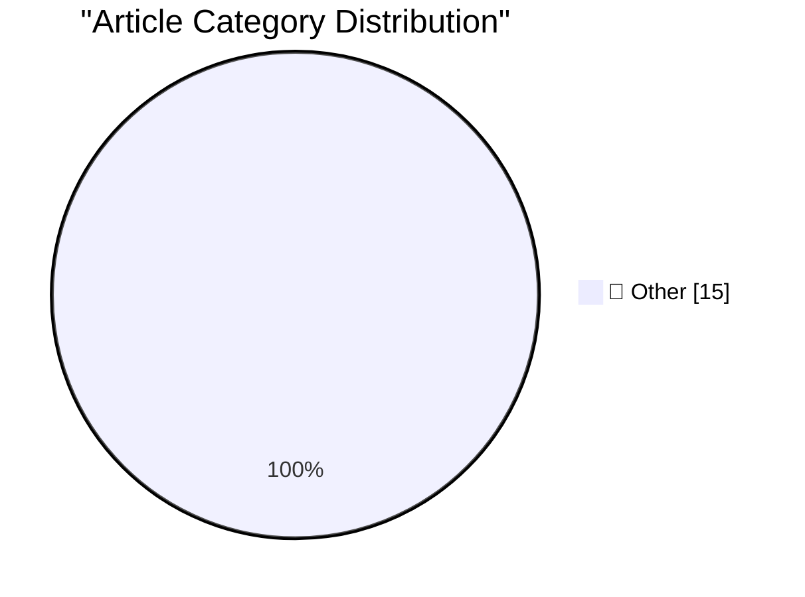

# 📰 AI Blog Daily Digest — 2026-10-17

> ⚠️ **Degraded run.** AI scoring failed for every batch — rankings and categories below are placeholder defaults, not AI-judged.

> From 92 top tech blogs (curated by Karpathy), AI-selected Top 15

## 🏆 Must Read

🥇 **Quoting Addy Osmani, Morgan Westlee Lunt, and Qing Wang**

simonwillison.net · 25m ago · 📝 Other

> We think "did a human read the code?" is an imprecise proxy for "what could go wrong with this change, and which check—automated or human—is the right one to catch it?" Asking that question also chang

🥈 **LaTeX renderer**

simonwillison.net · 1 days ago · 📝 Other

> Tool: LaTeX renderer Inspired by Paul Ford and Aboard Foundary's new web app Tiny Little Office , which provides a suite of web app content editors (a Word Processor, Outliner, Presentation Builder, S

🥉 **AI is driving a boom in modestly successful software projects**

seangoedecke.com · 22h ago · 📝 Other

> If AI is so great, why aren’t we seeing an explosion of new, amazing software products? If anyone can turn their idea into working software with coding agents, where is all that software ? People have

---

## 📊 Data Overview

| Scanned | Articles | Range | Selected |
|:---:|:---:|:---:|:---:|
| 87/92 | 2612 → 28 | 48h | **15** |

### Category Distribution

---

## 📝 Other

### 1. Quoting Addy Osmani, Morgan Westlee Lunt, and Qing Wang

[Link](https://simonwillison.net/2026/Oct/16/code-review/) — **simonwillison.net** · 25m ago · ⭐ 15/30

> We think "did a human read the code?" is an imprecise proxy for "what could go wrong with this change, and which check—automated or human—is the right one to catch it?" Asking that question also chang

---

### 2. LaTeX renderer

[Link](https://simonwillison.net/2026/Oct/15/latex/) — **simonwillison.net** · 1 days ago · ⭐ 15/30

> Tool: LaTeX renderer Inspired by Paul Ford and Aboard Foundary's new web app Tiny Little Office , which provides a suite of web app content editors (a Word Processor, Outliner, Presentation Builder, S

---

### 3. AI is driving a boom in modestly successful software projects

[Link](https://seangoedecke.com/ai-is-driving-a-boom-in-modestly-successful-software/) — **seangoedecke.com** · 22h ago · ⭐ 15/30

> If AI is so great, why aren’t we seeing an explosion of new, amazing software products? If anyone can turn their idea into working software with coding agents, where is all that software ? People have

---

### 4. How They Got Duo Support in NetNewsWire

[Link](https://netnewswire.blog/2026/10/16/how-we-got-duo-support.html) — **daringfireball.net** · 1h ago · ⭐ 15/30

> From the NetNewsWire blog: The latest version of NetNewsWire for iOS supports iPhone Duo, which is very much a novel iPhone with toolbars running up the side and all kinds of behavior. How we did it: 

---

### 5. ★ Real Artists Ship, Tesla Edition

[Link](https://daringfireball.net/2026/10/real_artists_ship_tesla_edition) — **daringfireball.net** · 2h ago · ⭐ 15/30

> If you think Musk is either completely legitimate and trustworthy or an utter fraud, you are wrong. He has led his companies to extraordinary accomplishments, *and* he has made promises based on compl

---

### 6. Shyam Sankar, CTO of Palantir, Says AI Researchers Have Started Smoking Because They’re Convinced AI (Claude, Probably) Is Going to Cure Cancer

[Link](https://www.cbsnews.com/news/shyam-sankar-chief-technology-officer-palantir-face-the-nation-transcript-10-11-2026/) — **daringfireball.net** · 5h ago · ⭐ 15/30

> From the transcript of Sunday’s Face the Nation on CBS: Shyam Sankar: You know, I take — I think there’s a profound truth to Pascal’s saying that every human has a god-shaped hole in their heart, and 

---

### 7. iPhone Duo Pre-Orders Launched, and Three Hours Later It’s Sold Out Through the End of January

[Link](https://www.macrumors.com/2026/10/16/iphone-duo-sold-out-for-christmas/) — **daringfireball.net** · 7h ago · ⭐ 15/30

> Joe Rossignol, MacRumors: If you were hoping to surprise someone with an iPhone Duo for Christmas, you might be out of luck, as Apple’s online store in the U.S. is already showing an estimated shippin

---

### 8. ★ Initial Thoughts on This Week’s New Apple TV 4K (4th Generation) and HomePod Mini 2

[Link](https://daringfireball.net/2026/10/thoughts_on_new_apple_tv_4k_and_homepod_mini_2) — **daringfireball.net** · 21h ago · ⭐ 15/30

> At the old pre-June prices, you could buy a 128 GB Apple TV and a pair of HomePod Minis for $350 ($150 + $100 + $100). Four short months later, with today’s new models, that combination would cost $60

---

### 9. This video is 2 minutes long

[Link](https://idiallo.com/byte-size/two-minutes-long-video) — **idiallo.com** · 17h ago · ⭐ 15/30

> As I mentioned before, it takes me way too long to edit a single video . So I am releasing it in chunks. If I never finish it, well then at least I'll have a few videos out. What is the video about? W

---

### 10. Pluralistic: Load-bearing (16 Oct 2026)

[Link](https://pluralistic.net/2026/10/15/sovereign-it/) — **pluralistic.net** · 15h ago · ⭐ 15/30

> Today's links Load-bearing: Digital sovereignty vs AI. Hey look at this: Delights to delectate. Object permanence: Anthrax penmanship; Stolen WEBGEEK license plate; Arizona Republic endorses Clinton, 

---

### 11. Book Review: Africa Is Not A Country - Breaking Stereotypes of Modern Africa by Dipo Faloyin ★★★★⯪

[Link](https://shkspr.mobi/blog/2026/10/book-review-africa-is-not-a-country-breaking-stereotypes-of-modern-africa-by-dipo-faloyin/) — **shkspr.mobi** · 10h ago · ⭐ 15/30

> It's hard to craft a book with so much righteous indignation - let alone make it funny, accessible, and informative. Nevertheless, Dipo Faloyin has succeeded in writing a spectacular takedown of the m

---

### 12. Meta: ever got stuck?

[Link](https://blog.coredump.cx/p/meta-ever-got-stuck) — **lcamtuf.substack.com** · 2h ago · ⭐ 15/30

> I have a quick question for regular readers: did you ever start reading an article on this blog, found the topic interesting, but then had to give up halfway through because you could make heads or ta

---

### 13. Yours truly

[Link](https://blog.coredump.cx/p/yours-truly) — **lcamtuf.substack.com** · 23h ago · ⭐ 15/30

> What’s truth? Does it matter? Should you be asking a blog?...

---

### 14. C++ futures part 5: std::future and std::shared_future

[Link](https://devblogs.microsoft.com/oldnewthing/20261016-00/?p=112778/) — **devblogs.microsoft.com/oldnewthing** · 8h ago · ⭐ 15/30

> Getting the results back out. The post C++ futures part 5: std:: future and std:: shared_future appeared first on The Old New Thing .

---

### 15. Movie password

[Link](https://www.johndcook.com/blog/2026/10/16/movie-password/) — **johndcook.com** · 6h ago · ⭐ 15/30

> I mentioned in the previous post that I watched 2010: The Year We Make Contact last night and got nerd-sniped by the mention of Lagrange points at the beginning. I got nerd-sniped again in a scene des

---

*Generated on 2026-10-17 | Scanned 87 sources → Found 2612 articles → Selected 15 articles*
*Based on [Hacker News Popularity Contest 2025](https://refactoringenglish.com/tools/hn-popularity/) RSS feeds list, curated by [Andrej Karpathy](https://x.com/karpathy).*
*Created by "Understand AI".*
