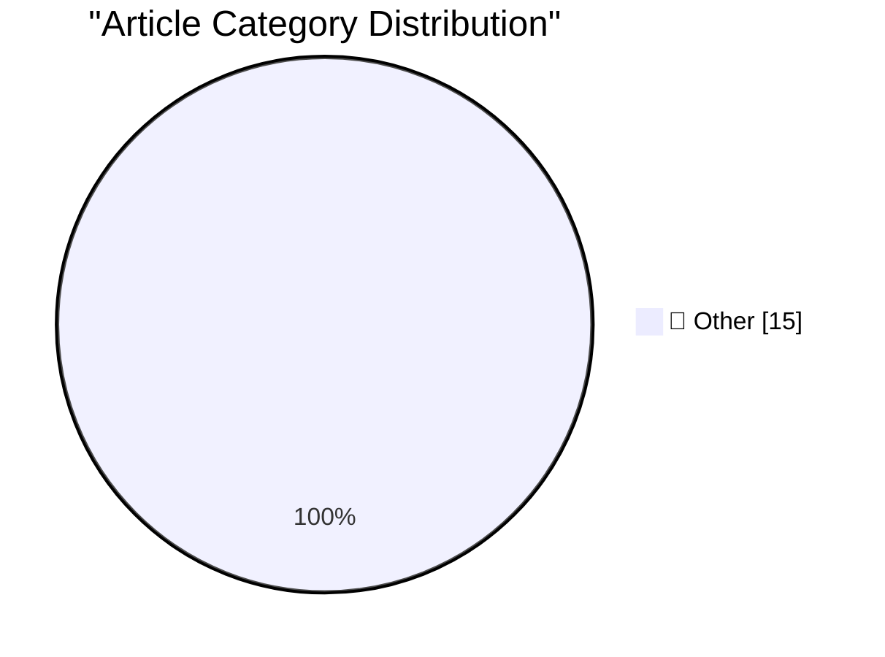

# 📰 AI Blog Daily Digest — 2026-10-26

> ⚠️ **Degraded run.** AI scoring failed for every batch — rankings and categories below are placeholder defaults, not AI-judged.

> From 92 top tech blogs (curated by Karpathy), AI-selected Top 15

## 🏆 Must Read

🥇 **battledrones v14: Compass Rose, a four player map**

simonwillison.net · 1 days ago · 📝 Other

> Release: battledrones v14: Compass Rose, a four player map I added four player online mode to Battledrones - previous maps were limited to two. Here's the initial prompt I used: Add a new map for a fo

🥈 **Don't anthropomorphize big tech companies**

seangoedecke.com · 23h ago · 📝 Other

> Bryan Cantrill has a great line from a talk where he cautions against anthropomorphizing 1 Oracle CEO Larry Ellison. I think it’s also a mistake to treat any tech company like a person. Here’s the ful

🥉 **Duo Users Are Registering the Base of Their Index Finger as a Touch ID Coping Strategy**

daringfireball.net · 2h ago · 📝 Other

> Some guy on Reddit (with an illustration video): Saw this online, tried it, and it works beautifully. Basically, I registered the lowest part of my right index finger. That part of the finger sits nat

---

## 📊 Data Overview

| Scanned | Articles | Range | Selected |
|:---:|:---:|:---:|:---:|
| 86/92 | 2507 → 31 | 48h | **15** |

### Category Distribution

---

## 📝 Other

### 1. battledrones v14: Compass Rose, a four player map

[Link](https://simonwillison.net/2026/Oct/24/battledrones/) — **simonwillison.net** · 1 days ago · ⭐ 15/30

> Release: battledrones v14: Compass Rose, a four player map I added four player online mode to Battledrones - previous maps were limited to two. Here's the initial prompt I used: Add a new map for a fo

---

### 2. Don't anthropomorphize big tech companies

[Link](https://seangoedecke.com/dont-anthropomorphize-big-tech-companies/) — **seangoedecke.com** · 23h ago · ⭐ 15/30

> Bryan Cantrill has a great line from a talk where he cautions against anthropomorphizing 1 Oracle CEO Larry Ellison. I think it’s also a mistake to treat any tech company like a person. Here’s the ful

---

### 3. Duo Users Are Registering the Base of Their Index Finger as a Touch ID Coping Strategy

[Link](https://www.reddit.com/r/iPhoneDuo/comments/1xehtcj/best_fingerprint_method/) — **daringfireball.net** · 2h ago · ⭐ 15/30

> Some guy on Reddit (with an illustration video): Saw this online, tried it, and it works beautifully. Basically, I registered the lowest part of my right index finger. That part of the finger sits nat

---

### 4. The Talk Show: ‘Lubricate the Inside of the Hinge’

[Link](https://daringfireball.net/thetalkshow/2026/10/25/ep-456) — **daringfireball.net** · 4h ago · ⭐ 15/30

> Special guest: Joanna Stern. Special topic: The iPhone Duo. Sponsored by: Factor : Healthy eating, made easy. Get 50% off and one free breakfast item per box for one year, while supplies last, with co

---

### 5. iPhone Portrait Mode, 10 Years In

[Link](https://x.com/johnnie/status/2114007844605612167) — **daringfireball.net** · 5h ago · ⭐ 15/30

> Speaking of Johnnie Manzari, he wrote a post yesterday marking the 10 year anniversary of Portrait Mode: Initially, Portrait mode was seen as a giant math problem. You’d do disparity calculations on t

---

### 6. Nicole Nguyen’s Duo Review for the WSJ

[Link](https://www.wsj.com/tech/personal-tech/iphone-duo-review-cafcbbe7?st=GaYVMf) — **daringfireball.net** · 1 days ago · ⭐ 15/30

> Nicole Nguyen (also with a 5-minute video ), writing for The Wall Street Journal (gift link): Every time I used the Duo in phone mode, one-handed, I felt its heft. It’s wider and thicker than a Pro iP

---

### 7. Reuters and the WSJ on the Duo Launch

[Link](https://www.reuters.com/business/retail-consumer/apple-bets-iphone-duo-can-remake-foldable-market-sales-begin-2026-10-22/) — **daringfireball.net** · 1 days ago · ⭐ 15/30

> Aditya Soni, Christine Chen, and Will Russell, reporting Friday for Reuters: CEO Ternus played greeter at a store in Austin, Texas, throwing open the doors and high-fiving customers as they streamed i

---

### 8. Marion Barry Meets the iPhone Duo

[Link](https://www.theverge.com/tech/1017623/iphone-duo-broken-cracked-screen) — **daringfireball.net** · 1 days ago · ⭐ 15/30

> Jay Peters, The Verge: The iPhone Duo officially goes on sale today, but a few units already have broken screens. According to posts on Reddit about the affected units, the issue appears to be happeni

---

### 9. MKBHD’s Duo Review

[Link](https://youtu.be/ESABTN4VtrA) — **daringfireball.net** · 1 days ago · ⭐ 15/30

> Marques Brownlee thinks the lack of Face ID will be the biggest gripe. I agree. And I love his central framing for the review: that the Duo is extremely polished around the edges (figuratively, but al

---

### 10. Tim Pan’s iPhone Duo Review

[Link](https://www.youtube.com/watch?v=8pCccpKjjos) — **daringfireball.net** · 1 days ago · ⭐ 15/30

> I hadn’t heard of Tim Pan or Mediastorm until running across his 24-minute video review of the Duo. It’s a good and fair review, but what struck me are the rather astonishing production values . Among

---

### 11. Apple Built a Photo-Realistic Functional Original iPod for Apple Music’s 404 Page

[Link](https://music.apple.com/404) — **daringfireball.net** · 1 days ago · ⭐ 15/30

> It seems like this amazing Easter egg only launched yesterday, to celebrate the original iPod’s 25th anniversary . Exquisitely well done. More like this, please. ★

---

### 12. Chan Karunamuni on the Duo’s Open/Close Translucent Transition

[Link](https://x.com/chan_k/status/2113622379050246243) — **daringfireball.net** · 1 days ago · ⭐ 15/30

> Chan Karunamuni, human interface designer at Apple, on X: iPhone Duo is here! Excited to have worked on the design of our open/close transition. It’s designed to make the two displays feel like one se

---

### 13. Gadget Review: LiberNovo Omni - the USB-C powered office chair ★★★★⯪

[Link](https://shkspr.mobi/blog/2026/10/gadget-review-libernovo-omni-chair/) — **shkspr.mobi** · 11h ago · ⭐ 15/30

> Whenever a company asks me to review their gadgets, I always ask if it is USB-C powered. If not, I'm not interested. So, welcome to the future where your chair is USC-C rechargeable! WHAT?! The LiberN

---

### 14. Book Review: Get Ahead of Being Dead by Evie King ★★★★☆

[Link](https://shkspr.mobi/blog/2026/10/book-review-get-ahead-of-being-dead-by-evie-king/) — **shkspr.mobi** · 1 days ago · ⭐ 15/30

> After reading Evie King's previous book Ashes To Admin - Tales from the Caseload of a Council Funeral Officer I was eager to read her not-quite-a-sequel. We know what happens after death; paperwork. G

---

### 15. Stop! Ontology time!

[Link](https://blog.coredump.cx/p/stop-ontology-time) — **lcamtuf.substack.com** · 1 days ago · ⭐ 15/30

> Is that a *hole* in your reasoning?

---

*Generated on 2026-10-26 | Scanned 86 sources → Found 2507 articles → Selected 15 articles*
*Based on [Hacker News Popularity Contest 2025](https://refactoringenglish.com/tools/hn-popularity/) RSS feeds list, curated by [Andrej Karpathy](https://x.com/karpathy).*
*Created by "Understand AI".*
